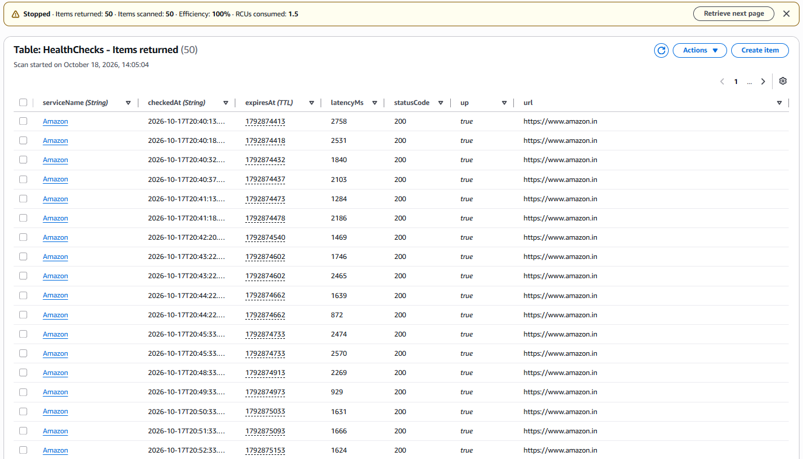
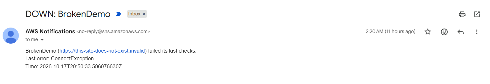

# Service Health Monitor

A Java service that watches websites and APIs, saves every check to **Amazon DynamoDB**,
and emails an alert through **Amazon SNS** when a service goes down or recovers.

Built to practice outage detection: spot problems early, avoid false alarms, and keep a history
you can use to find the root cause.

## How it works

```
                 every N seconds
 services.properties ──► Monitor ──► HealthChecker ──► HTTP GET each service
                            │                                │
                            │                         CheckResult (status, latency, error)
                            │                                │
                            ├──► ResultStore ──► DynamoDB (history, auto-deleted after 7 days)
                            │
                            └──► StatusTracker ──► DOWN after N failures in a row?
                                                        │ yes (state changed)
                                                        ▼
                                                  Alerter ──► SNS ──► your email
```

| Class | Job |
|---|---|
| `HealthChecker` | Sends one HTTP request, measures latency, never throws |
| `StatusTracker` | Declares DOWN only after N failures in a row; alerts once per change, not every minute |
| `Monitor` | Schedules checks, saves results, triggers alerts |
| `DynamoDbResultStore` / `SnsAlerter` | AWS versions of storage and alerting |
| `ConsoleResultStore` / `ConsoleAlerter` | Local versions, used when AWS is not configured |

**Design choices**
- **Consecutive-failure threshold** (default 3) so one slow request doesn't cause a false alarm.
- **Alert on state change only**, so an outage sends one DOWN email and one RECOVERED email.
- **Storage or alert failures never stop monitoring**; they are logged and the loop continues.
- **Interfaces for storage and alerts**, so the AWS pieces can be swapped or tested without AWS.

## Results

Deployed on an AWS EC2 `t3.micro` (ap-southeast-2), monitoring 4 services every 60 seconds.
Every check is stored in DynamoDB, and an SNS email alert is sent once when a service fails
3 checks in a row.

| Metric | Value |
|---|---|
| Monitoring period | 17 Oct 2026 – 23 Oct 2026 (about 6 days, continuous) |
| Total checks stored | 34,020 |
| Endpoints | Amazon (amazon.in), GitHub, Google, BrokenDemo |
| Check interval | 60 seconds |

### Availability and latency

| Service | Checks | Availability | p50 | p95 |
|---|---|---|---|---|
| GitHub | 8,505 | 99.98% | 22 ms | 32 ms |
| Google | 8,505 | 99.98% | 215 ms | 405 ms |
| Amazon (amazon.in) | 8,505 | 99.96% | 1,604 ms | 2,273 ms |
| BrokenDemo | 8,505 | 0.00% | 2 ms | 10 ms |

`BrokenDemo` is a deliberately failing endpoint used to verify that alerting works.
Amazon's higher latency is expected: the monitor ran in Sydney while amazon.in is served from India.

### Transient failures observed

Across the three real services, 7 of 25,515 checks failed (about 99.97% availability overall).
No service failed more than twice in a row, so none reached the 3-failure threshold.

| Time (UTC) | Service | Failure |
|---|---|---|
| 19 Oct 19:05 | Amazon | HTTP 503 |
| 20 Oct 22:16, 22:17 | Google | Timeout (5 s) |
| 21 Oct 18:17 | GitHub | HTTP 502 |
| 21 Oct 18:18, 18:19 | Amazon | Timeout, then connection error |
| 23 Oct 13:19 | GitHub | Timeout |

The failures on 21 Oct (GitHub, then Amazon, within about two minutes) point to a brief network
issue on the monitoring host rather than separate outages. This is why checking from multiple
regions is listed under the ideas below.

### Alerting behaviour

Because a DOWN alert needs 3 failures in a row and alerts fire only on a state change, the
transient failures above did not generate false alarms, and `BrokenDemo` produced a single DOWN
alert instead of one email per check.

**Check results stored in DynamoDB**



**DOWN alert email received through SNS**



## Run it locally (no AWS needed)

Requirements: Java 17+ and Maven.

```bash
mvn package
java -jar target/health-monitor.jar services.properties
```

Edit `services.properties` to list your own services (`Name=URL`). The `BrokenDemo` entry always
fails, so you will see a DOWN alert in the console after 3 checks.

Run the unit tests with `mvn test`.

## Configuration (environment variables)

| Variable | Default | Meaning |
|---|---|---|
| `CHECK_INTERVAL_SECONDS` | 60 | How often each service is checked |
| `FAILURE_THRESHOLD` | 3 | Failures in a row before a service is DOWN |
| `DYNAMODB_TABLE` | (none) | Save results to this table; if unset, prints to console |
| `SNS_TOPIC_ARN` | (none) | Send alerts to this topic; if unset, prints to console |

## Run it on AWS

1. **DynamoDB:** create a table, e.g. `HealthChecks`, partition key `serviceName` (String), sort key
   `checkedAt` (String), on-demand capacity. Optionally enable **TTL** on the attribute `expiresAt`.
2. **SNS:** create a Standard topic `health-alerts`, add an **Email** subscription, and confirm it
   from the email AWS sends you. Copy the topic ARN.
3. **IAM:** give the machine a role (or user) allowed to run `dynamodb:PutItem` on the table and
   `sns:Publish` on the topic. Use least privilege, not admin.
4. **EC2:** launch a small Linux instance with that role attached, install Java 17, copy
   `health-monitor.jar` and `services.properties` to it.
5. Run it:
   ```bash
   export AWS_REGION=ap-southeast-2
   export DYNAMODB_TABLE=HealthChecks
   export SNS_TOPIC_ARN=arn:aws:sns:ap-southeast-2:<account-id>:health-alerts
   nohup java -jar health-monitor.jar services.properties > monitor.log 2>&1 &
   ```
6. Check the DynamoDB table in the console to see results arriving, and temporarily add a bad URL to
   test the email alert.

**Cost:** DynamoDB on-demand, SNS email, and a small instance are very cheap at this scale. Use the
AWS Free plan, set billing alerts, and stop or terminate the instance when you are done.

## Ideas to extend

- Run checks from multiple regions, so a local network problem isn't mistaken for a service outage.
- Query a service's last 24 hours of latency and print p50/p95 latency.
- Add a small REST endpoint (`/status`) that shows the current state of each service.
- Check response body content, not just the status code.
- Package as a Docker image or run the checks from Lambda on an EventBridge schedule.
